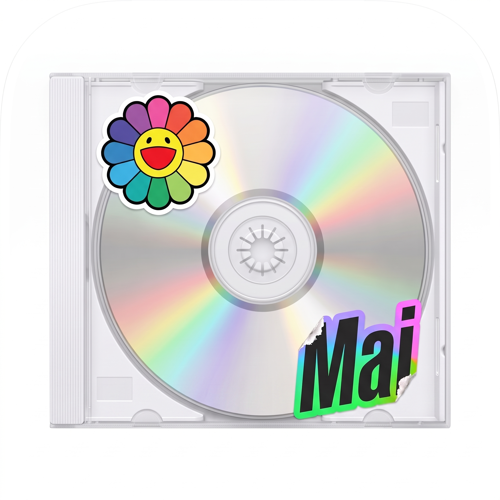

<div align="center">
    
    <h1>Mai dial</h1>
    <p>
        Turn a YouTube video's tracklist into a Tidal playlist.
    </p>
    <p>
        Made with love by <a href="https://github.com/jakedogguy">@jakedogguy</a>
    </p>
</div>

## About
Mai dial reads the tracklist in a YouTube video's description and turns it
into a Tidal playlist. No API keys, no copy-pasting songs one by one.

Paste the link, review the matches, get the playlist. That simple.

## How it works
- Reads the video's title, description and thumbnail with
[yt-dlp](https://github.com/yt-dlp/yt-dlp).
- Finds the songs and albums in the description: timestamps, numbered lists,
`artist - title`, `title by artist`, and so on.
- Searches each one on Tidal and shows a table of matches: green is sure,
yellow is doubtful, red is not found.
- You decide on the doubtful ones, then Mai dial creates the playlist named
after the video.

> [!NOTE]
> Tidal's API can't set playlist images yet. The thumbnail is saved to
> `covers/`, and Mai dial opens the playlist and the cover so you can set it
> by hand.

## Install
```sh
py -m venv .venv
.venv\Scripts\activate        # Windows (source .venv/bin/activate elsewhere)
pip install -e .
```

## Usage
```sh
mai "https://www.youtube.com/watch?v=..."
```
Or just run `mai` and paste the link when asked.

The first run asks you to log in to Tidal: open the link shown and approve it.
No developer app or token needed.

## Your secrets
> [!IMPORTANT]
> Mai dial never asks for your Tidal password. It uses Tidal's device login and
> saves the session to `~/.mai/tidal_session.json`, outside this repository.
> Treat that file like a password: don't share it or commit it.
> Delete it to log out.

## Development
```sh
pip install -e ".[dev]"
pytest
```

## Credits
Mai dial is built on top of these open source projects:

- [tidalapi](https://github.com/tamland/python-tidal) talks to Tidal and
handles the device login.
- [yt-dlp](https://github.com/yt-dlp/yt-dlp) fetches the video's metadata and
thumbnail.
- [rich](https://github.com/Textualize/rich) draws the review table in the
terminal.
